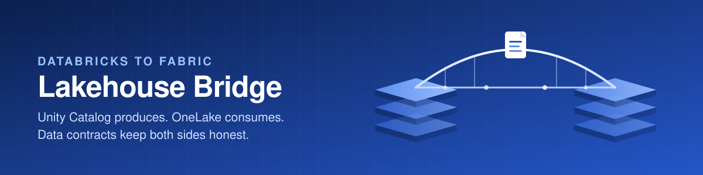
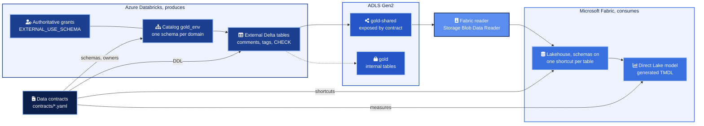
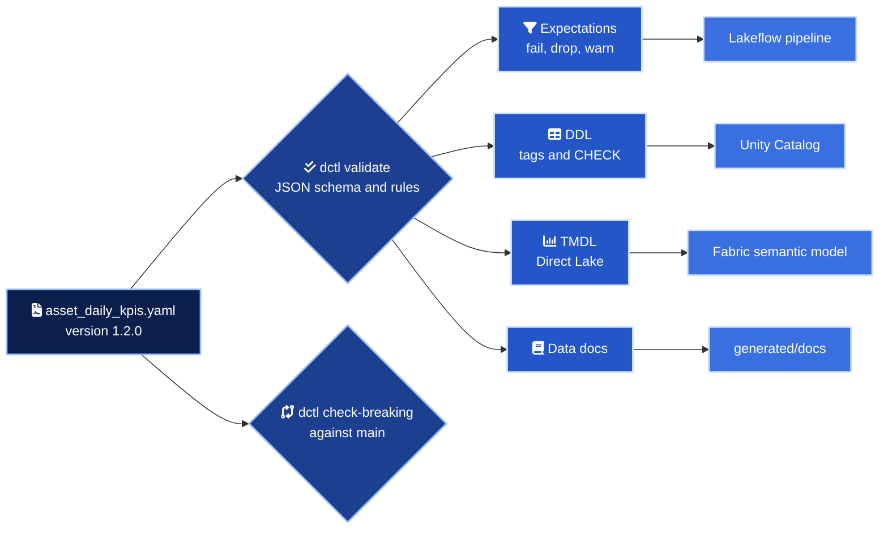
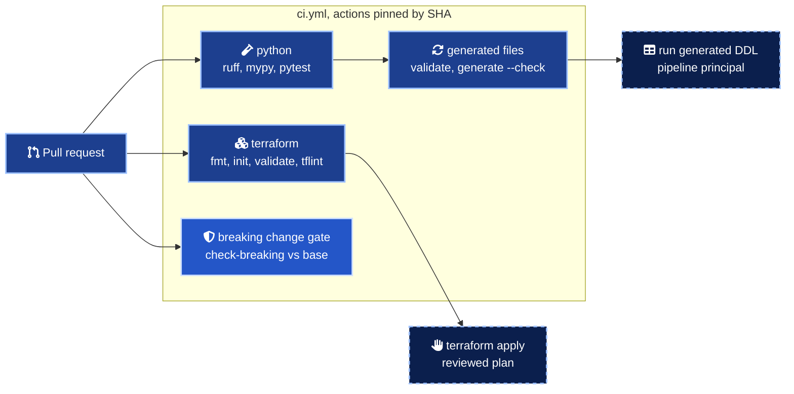

<div align="center">



# databricks-fabric-lakehouse-bridge

Databricks writes the gold layer, Fabric reads it without a copy, and a data contract decides what crosses the bridge.

<a href="https://learn.microsoft.com/azure/databricks/data-governance/unity-catalog/"></a>
<a href="https://learn.microsoft.com/fabric/onelake/onelake-shortcuts"></a>
<a href="https://learn.microsoft.com/fabric/fundamentals/direct-lake-overview"></a>
<a href="https://developer.hashicorp.com/terraform"></a>
<a href="https://www.python.org/"></a>
<a href=".github/workflows/ci.yml"></a>

</div>

## In numbers

| Measure | Count | Where it comes from |
| --- | --- | --- |
| Data contracts | 3 | `asset_daily_kpis`, `energy_consumption`, `quality_events`, one per domain schema |
| Contracted columns and DAX measures | 30 and 9 | Every column typed, described and classified |
| Generated expectations | 58 | 6 fail, 50 drop, 2 warn, in `generated/lakeflow/` |
| Generated CHECK constraints | 25 | Drop and fail rules that Delta accepts as constraints |
| Generated files under version control | 17 | Expectations, DDL, Direct Lake TMDL, data docs |
| Breaking change rules | 15 | `src/contracts/dctl/diff.py`, enforced on every pull request |
| Terraform resource blocks | 19 | 12 Databricks, 6 Fabric, 1 Azure |
| Input variables with validation | 13 of 17 | 15 validation rules in `infra/variables.tf` |
| Test cases | 122 | Validation, golden files, breaking changes, CLI against a real git history |
| CI jobs | 3 | Terraform, Python, breaking change gate, actions pinned by SHA |
| Architecture decision records | 3 | `docs/adr` |

## What it is

A reference implementation for teams that build their lakehouse in Azure Databricks and serve it in Microsoft Fabric and Power BI. It shows how both platforms share one copy of the gold layer while governance stays in code. Unity Catalog grants, storage roles, Fabric shortcuts and the semantic model all derive from the same YAML contracts.

The contracts do more than document. A small tool, `dctl`, validates them and generates pipeline expectations, Delta DDL with tags and constraints, a Direct Lake semantic model and data docs. In CI it blocks any pull request that would break a consumer without a new major version.

## Architecture



Databricks owns every write. Fabric reads the Delta folders of the tables whose contract says `exposure: shortcut`, through a service principal that can read the shared container and nothing else. No data is copied and Fabric never writes back.

## From one contract to every artefact



Here is the gate at work on [`examples/asset_daily_kpis.proposed.yaml`](examples/asset_daily_kpis.proposed.yaml), a change that adds a column and quietly breaks three promises.

```text
$ dctl diff contracts/asset_daily_kpis.yaml examples/asset_daily_kpis.proposed.yaml
examples/asset_daily_kpis.proposed.yaml: asset_daily_kpis 1.2.0 -> 1.3.0
  [breaking] columns/availability: now nullable, consumers may receive NULL
  [breaking] consumers/fabric/measures/Reject Rate: removed
  [breaking] sla/freshness: loosened from 26 h to 36 h
  [compatible] columns/shift_count: added
  BLOCKED 3 breaking change(s) need a new major version, 1.2.0 to 2.0.0
```

## Environments

| | `dev` | `prod` |
| --- | --- | --- |
| Unity Catalog catalog | `gold_dev` | `gold_prod` |
| Fabric workspace | `lakehouse-bridge-dev` | `lakehouse-bridge-prod` |
| Fabric lakehouse | `gold_dev` | `gold_prod` |
| Generated files | Committed in `generated/` | Rendered at release with `--catalog gold_prod` and the prod storage account |
| Semantic model | Off by default | On once the shortcuts hold data |

The `environment` variable accepts `dev`, `test` and `prod`. Everything else that changes between them comes from `terraform.tfvars`.

## Quick start

Run every check locally. No cloud account needed.

```bash
git clone https://github.com/marlyngiselle/databricks-fabric-lakehouse-bridge.git
cd databricks-fabric-lakehouse-bridge
python3 -m venv .venv
.venv/bin/pip install -e ".[dev]"
.venv/bin/dctl validate
.venv/bin/dctl generate --check
.venv/bin/pytest
terraform -chdir=infra init -backend=false && terraform -chdir=infra validate
```

Try the breaking change gate.

```bash
.venv/bin/dctl diff contracts/asset_daily_kpis.yaml examples/asset_daily_kpis.proposed.yaml
```

Deploy. Set your own IDs in `terraform.tfvars` first. The secret is read from the prompt and never written to a file.

```bash
cp infra/terraform.tfvars.example infra/terraform.tfvars
read -rs TF_VAR_fabric_reader_secret && export TF_VAR_fabric_reader_secret
az login
terraform -chdir=infra init
terraform -chdir=infra plan -out=bridge.tfplan
terraform -chdir=infra apply bridge.tfplan
```

Then run `generated/ddl/*.sql` on a SQL warehouse as the pipeline principal, let the pipeline load the tables, and turn the semantic model on.

```bash
terraform -chdir=infra apply -var deploy_semantic_model=true
```

## Access model

| Principal | Unity Catalog | Storage | Fabric |
| --- | --- | --- | --- |
| `platform-admins` | Owns the catalog and the external locations | Location owner | Workspace admin |
| Pipeline service principal | Writes the domain schemas | Reads and writes both containers | None |
| Domain owner group | Owns its schema and tables | None | None |
| Domain steward group | Reads and tags its schema | None | None |
| `data-analysts` | Reads gold | None | Workspace viewer |
| Fabric reader | Reads shared schemas, `EXTERNAL_USE_SCHEMA` | Reads `gold-shared` only | Identity of the connection |

Owner and steward groups come from the contracts. The full matrix and the classification policy are in [docs/governance.md](docs/governance.md).

## Delivery



Checks run on every pull request and every push to `main`. The gate runs on pull requests only, against the target branch. Applying infrastructure and running DDL stay deliberate steps.

## Before you touch anything

> [!WARNING]
> A OneLake shortcut reads Delta files with a storage identity. Unity Catalog row filters and column masks do not run on the Fabric side. That is why a contract with a `restricted` column cannot use `exposure: shortcut`, and why both `dctl validate` and a Terraform precondition refuse it.

> [!CAUTION]
> `databricks_grants` is authoritative. Any privilege granted by hand on the catalog, the schemas, the storage credential or the external locations is revoked on the next apply.

> [!IMPORTANT]
> The stack needs Terraform 1.11 or later. The Fabric connection secret travels through an ephemeral variable into a write-only argument, so it never reaches the plan or the state. CI pins 1.13.4.

> [!WARNING]
> If the storage account denies public network access, the shortcut needs a network path from Fabric, for example trusted workspace access. It relies on the workspace identity that this stack creates and exposes as `fabric_workspace_identity`.

> [!NOTE]
> The `microsoft/fabric` provider 1.14.0 cannot declare a mirrored Azure Databricks catalog. Its `fabric_mirrored_catalog` targets Iceberg REST catalogs. The Fabric reader already holds the Unity Catalog grants mirroring needs, so switching later is a Fabric change only. See [docs/integration-patterns.md](docs/integration-patterns.md).

## Repository map

| Path | What it holds |
| --- | --- |
| `contracts/` | One YAML contract per gold table, the single source of truth |
| `src/contracts/dctl/` | The `dctl` tool, its JSON schema, the generators and the diff engine |
| `generated/` | Expectations, DDL, TMDL and docs rendered from the contracts, checked in CI |
| `infra/unity_catalog.tf` | Storage credential, two external locations, catalog, domain schemas, tags |
| `infra/grants.tf` | Authoritative grants on every securable |
| `infra/identity.tf` | Fabric reader in Databricks and its storage role on the shared container |
| `infra/fabric.tf` | Workspace, roles, lakehouse, connection, shortcuts, semantic model |
| `examples/` | A proposed contract change that the gate blocks |
| `tests/` | Pytest suite with golden files and a throwaway git repository |
| `docs/` | Architecture, governance, integration patterns, contract rules, ADRs |
| `.github/workflows/ci.yml` | Terraform, Python and breaking change gate |

## Documentation

| Document | What it answers |
| --- | --- |
| [Architecture](docs/architecture.md) | How Databricks produces, Fabric consumes, and what happens when a contract changes |
| [Governance and access model](docs/governance.md) | Who can read what on each side, the classification policy, how the secret is handled |
| [Shortcuts, mirroring or copy](docs/integration-patterns.md) | The decision matrix and why shortcuts are the default today |
| [Data contracts](docs/data-contracts.md) | Contract sections, validation rules, generated outputs and the breaking change table |
| [ADR 0001](docs/adr/0001-onelake-shortcuts-as-the-default-integration.md) | Why OneLake shortcuts are the default integration |
| [ADR 0002](docs/adr/0002-gold-as-external-tables-in-a-shared-container.md) | Why gold tables are external and split across two containers |
| [ADR 0003](docs/adr/0003-contracts-drive-code-generation-and-the-ci-gate.md) | Why contracts drive the generated code and the CI gate |

<div align="center">
<br>
<sub>Built by Giselle Da Costa · Data and AI platform architecture · MIT licensed</sub>
</div>
