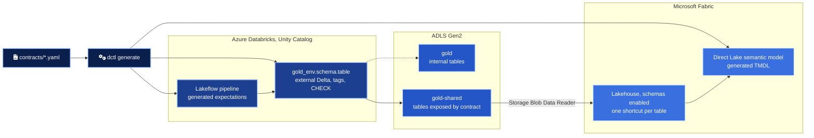
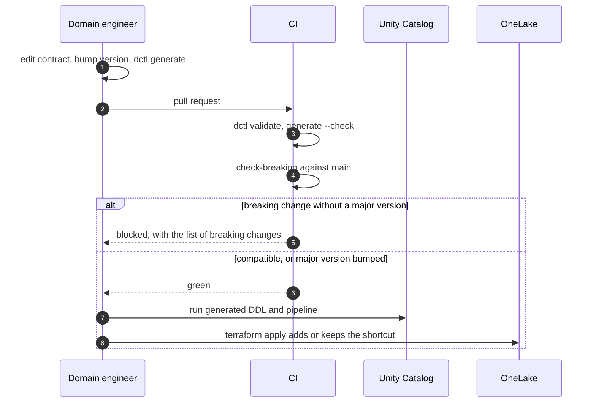

# Architecture

Databricks produces the gold layer and Fabric consumes it. Neither side copies data, and neither side guesses what the other one means by a column. The contract in `contracts/` is the agreement, and everything else is generated from it or checked against it.

## Components

| Component | Owner | Defined in |
| --- | --- | --- |
| Gold catalog, one schema per domain | Platform team | `infra/unity_catalog.tf` |
| Grants on catalog, schemas, external locations | Platform team | `infra/grants.tf` |
| Gold tables, comments, tags, constraints | Domain team | `generated/ddl/`, from the contract |
| Pipeline expectations | Domain team | `generated/lakeflow/`, from the contract |
| Fabric reader identity and its storage role | Platform team | `infra/identity.tf` |
| Fabric workspace, lakehouse, connection, shortcuts | Platform team | `infra/fabric.tf` |
| Semantic model | Domain team | `generated/semantic_model/`, deployed by `infra/fabric.tf` |

## Two containers, one rule

Tables exposed to Fabric live under `gold-shared`, at `<schema>/<table>`. Everything else lives under `gold`. The Fabric reader holds `Storage Blob Data Reader` on `gold-shared` only, so the storage boundary and the contract say the same thing. Moving a table from one container to the other means changing `consumers.fabric.exposure` in its contract, which the breaking change gate classifies.

Gold tables are external Delta tables at a path the contract determines. Managed tables live under a generated path that a shortcut cannot target by name, and Databricks does not support reading managed table files directly. See [ADR 0002](adr/0002-gold-as-external-tables-in-a-shared-container.md).

## What happens when a contract changes

## Delta features and Fabric readers

A shortcut hands Fabric the Delta log as Databricks wrote it. Fabric then reads it with its own engines, so every table feature turned on in Databricks must be one the Fabric readers support. The generated DDL turns on change data feed and liquid clustering only. Check the Fabric documentation before enabling a new table feature on a shared table, and treat that change like a schema change.

## What this repository does not do

The pipelines that compute the gold tables, the Azure foundation (workspace, network, storage account, access connector) and freshness monitoring are out of scope. The contracts declare the freshness SLA and the DDL tags each table with it, so a monitor can read both.
